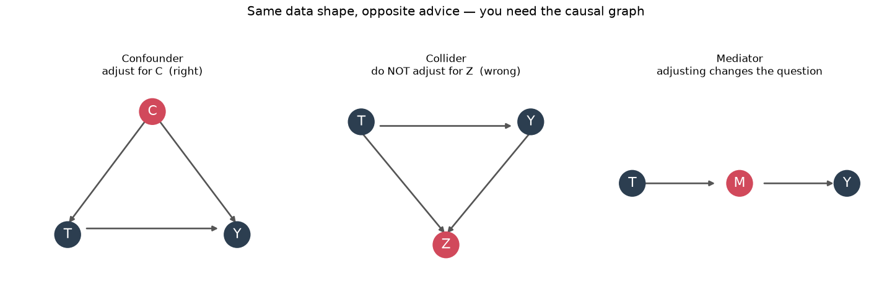
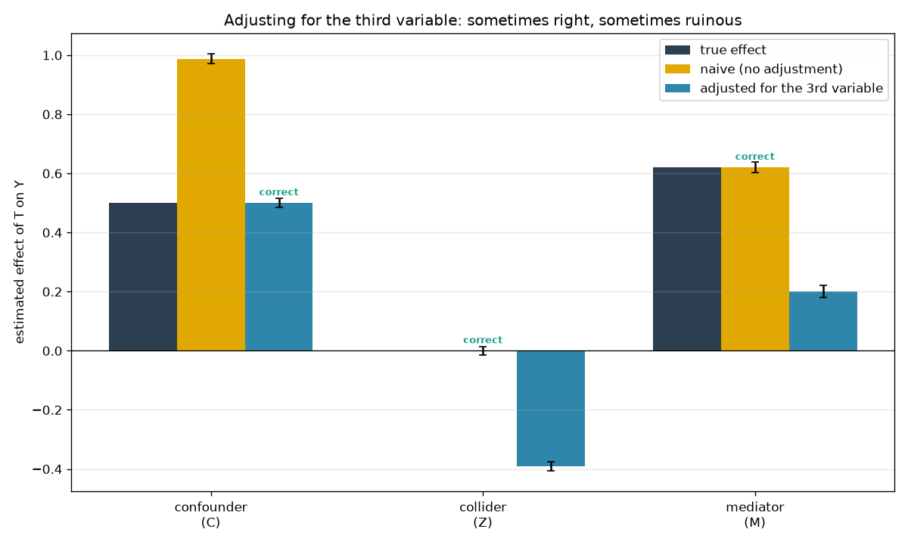
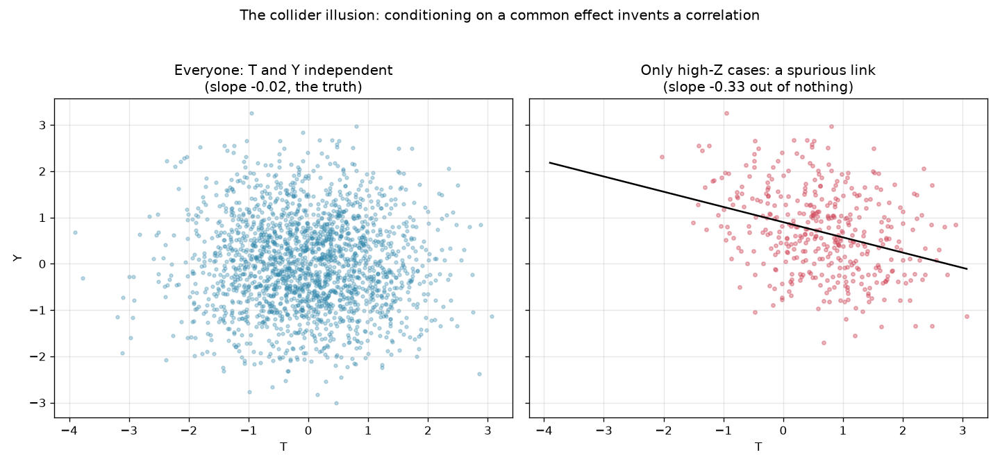

# Causal Traps — correlation, causation, and the control-for-everything trap

"Correlation isn't causation" is the first thing anyone learns about data. The
second thing — the one that actually trips people up — is that the usual fix,
*"just control for everything you can measure,"* is wrong, and sometimes
spectacularly so. This project shows exactly when adjusting for a variable rescues
your estimate and when it wrecks it, using simulations where the true causal effect
is known so there's a right answer to check against.

Three worlds, each with a treatment **T**, an outcome **Y**, and one extra
variable. The data looks the same shape in all three — three columns of numbers —
but the extra variable plays a different causal role in each, and that role flips
the correct analysis on its head.



> **The finding (300 simulations each):**
>
> | world | true effect | naive estimate | adjusted estimate | correct move |
> |---|---|---|---|---|
> | **confounder** (C) | 0.50 | **0.99** | 0.50 | adjust for C |
> | **collider** (Z) | 0.00 | 0.00 | **−0.39** | do NOT adjust for Z |
> | **mediator** (M) | 0.62 | 0.62 | 0.20 | depends what you're asking |
>
> Adjusting fixes the confounder, *invents* an effect in the collider (−0.39 out of
> a true zero), and silently answers a different question for the mediator. Same
> three columns; opposite advice.



## The three traps

- **Confounder** — `C → T`, `C → Y`. A common *cause* makes T and Y move together
  even beyond T's real effect. The naive estimate (0.99) is nearly double the truth
  (0.50); adjusting for C removes the backdoor path and recovers it. This is the
  case everyone has in mind, and here controlling is exactly right.
- **Collider** — `T → Z ← Y`. A common *effect*. T and Y are genuinely unrelated
  (true effect 0), and the naive estimate correctly says so — until you control for
  Z, which opens a spurious path and manufactures a −0.39 "effect" from nothing.
- **Mediator** — `T → M → Y` (plus a little direct `T → Y`). M is a step *on* the
  causal path. The naive estimate gives the **total** effect (0.62); adjusting for M
  gives the **direct** effect (0.20). Neither is wrong — but if you wanted the total
  effect and controlled for M out of habit, you'd report less than a third of it.

## The collider illusion, in one picture



T and Y are independent in the full population (left: a shapeless blob). Look only
at cases where their common effect Z is high (right) and a clean negative
relationship appears — entirely an artifact of the selection. This is why, "among
hired candidates, test scores and interview scores are often negatively correlated"
even when they're unrelated in the applicant pool: you conditioned on a collider
(getting hired) without realizing it.

## Install & run

```bash
pip install -r requirements.txt
python -m causal_traps                 # 300 sims per scenario; prints table, saves charts
python -m causal_traps --trials 1000 --n 8000
```

## Reading the result honestly

- **You cannot tell these apart from the data alone.** The confounder, collider, and
  mediator simulations can be tuned to produce near-identical correlation matrices.
  Which variable is which comes from *domain knowledge about the causal direction* —
  the arrows in the diagram — not from anything in the numbers. That's the whole
  reason causal inference needs a model of the world, not just a regression.
- **"Control for everything" is actively dangerous.** Throwing every available
  variable into a regression will, sooner or later, include a collider or a mediator
  and bias the very estimate you were trying to clean up.
- **These are the simplest possible cartoons.** Real problems mix all three roles at
  once, have unmeasured confounders you *can't* adjust for, and use designs
  (instruments, natural experiments, randomization) that this toy doesn't attempt.
  The point here is the mechanism, shown cleanly — not a turnkey causal pipeline.

## What's inside

- `dgp.py` — the three data-generating processes, each returning data plus the known
  true effect and whether adjusting for the extra variable is the right move
- `estimate.py` — a small OLS (with standard errors) and the effect-of-T estimate,
  with or without adjustment
- `experiment.py` — Monte-Carlo each scenario to show the bias is systematic
- `plots.py` — the DAG diagrams, the bias summary, and the collider-illusion scatter
- `cli.py` — the command-line entry point

## Tests

```bash
python -m pytest
```

All 8 tests run offline and deterministically: the OLS recovers known coefficients
exactly on noiseless data, and each scenario is pinned to its lesson — adjusting
must recover the truth for the confounder, must *introduce* bias for the collider,
and must return the smaller direct effect for the mediator.
