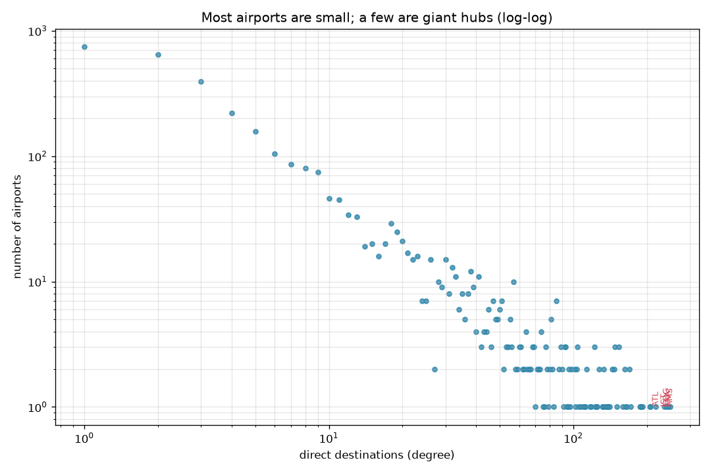
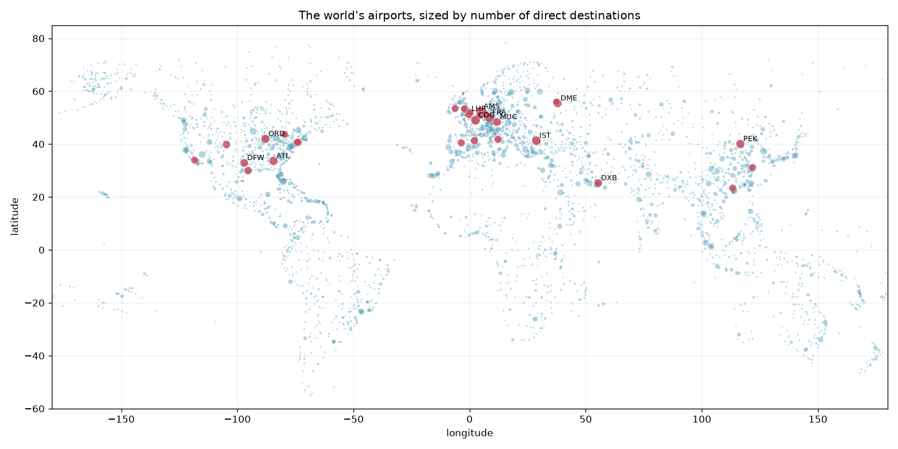
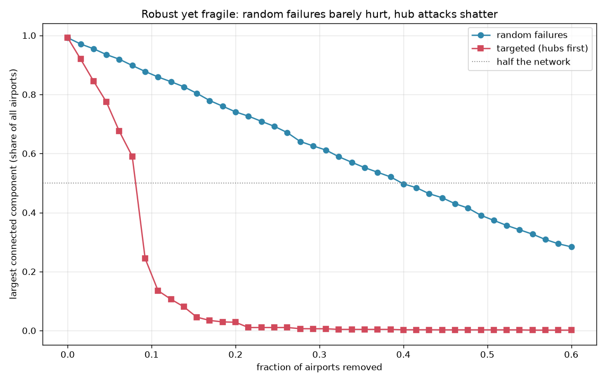

# Flight Network — robust yet fragile

The world's airports and the routes between them form one giant network, and that
network has two surprising properties that turn out to be two sides of the same coin.
First, it's a **small world**: you can get from almost any airport to almost any
other in about four flights. Second, it's **robust yet fragile**: close hundreds of
random airports and the network barely notices, but close its few big hubs and the
whole thing falls apart. Both come from the same lopsided structure — a handful of
giant hubs holding a sea of small airports together.

Built from the [OpenFlights](https://openflights.org/data.html) dataset: **3,257
airports** joined by **18,930 non-stop routes**.

## A few giant hubs, a sea of small airports



The number of direct destinations per airport is wildly unequal. Most airports
connect to a handful of others; a few — Amsterdam, Frankfurt, Paris, Istanbul,
Atlanta — connect to well over 200. On a log-log axis the long heavy tail is clear:
this is a hub-dominated ("scale-free-ish") network, not an egalitarian one.



Plot every airport at its coordinates and the continents draw themselves; color the
mega-hubs and the structure of global aviation appears — dense cores in North
America, Europe, and East Asia, stitched together by the big international hubs.

## Four degrees of airports

```
Giant component: 99.2% of all airports
Average hops between airports: 3.97  (longest sampled: 12)
```

99.2% of airports sit in a single connected component, and the average shortest path
between them is just **~4 hops**. A sprawling network of thousands of nodes is, in
travel terms, tiny — the small-world effect, because the hubs act as shortcuts.

## Robust yet fragile



Now remove airports and watch the largest connected component. Two orders, opposite
outcomes:

```
Fraction of airports removed to break the network below 50% connected:
  random failures:       40%
  targeted (hubs first):  9%
```

- **Random failures barely hurt.** Knock out airports at random and the network
  degrades gracefully — you have to remove ~40% before it splits apart, because a
  random airport is almost always a small one whose loss is local.
- **Targeted hub removal is catastrophic.** Remove airports biggest-first and the
  network collapses almost at once — below half-connected after just ~9% removed, and
  nearly shattered by ~20%. The very hubs that make it a small world are also its
  single point of failure.

This "robust yet fragile" signature is why hub-structured systems — air travel, the
internet's backbone, power grids, even ecosystems and financial networks — survive
random shocks so well and targeted ones so badly.

## Install & run

```bash
pip install -r requirements.txt
python -m flight_network                 # uses the committed snapshot
python -m flight_network --collect       # re-download OpenFlights first
```

## How it works

- `data.py` — download and parse OpenFlights into an undirected airport graph;
  cache a compact edge list and airport table (`data/`)
- `graph.py` — degrees, the giant component, the degree distribution, and the
  sampled average shortest-path length (via `scipy.sparse.csgraph`)
- `robustness.py` — remove nodes in random vs. hub-first order and track the giant
  component; the `collapse_point` where it drops below half
- `plots.py` — the degree tail, the hub map, and the robustness curves
- `cli.py` — the command-line entry point

## Reading the result honestly

- **An edge means "a route exists," not "a lot of traffic."** This is the
  *topology* of where you can fly, unweighted by seats or frequency. A traffic-
  weighted network would make the hubs look even more dominant.
- **Paths are in flights, not time or price.** "Four hops" is four legs; it says
  nothing about layovers or cost, and treats a puddle-jumper like a transatlantic.
- **It's an undirected snapshot (~2014).** Most routes run both ways, so treating
  them as undirected is reasonable, but the dataset is a community snapshot of its
  era, not today's live schedule. The structural lessons are what travel, not the
  exact numbers.

## Tests

```bash
python -m pytest
```

All 7 tests run offline against hand-built graphs with known answers: degrees of a
star, the giant-component fraction of a split graph, the exact average path length of
a 3-node path, and — the headline — that removing a star's hub first shatters it while
removing it last does not, so targeted attacks collapse a hub network far faster than
random ones.
