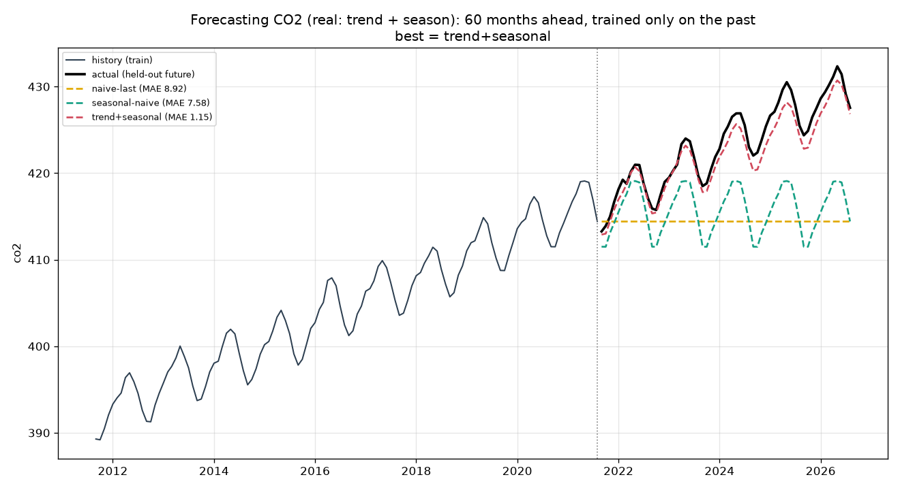
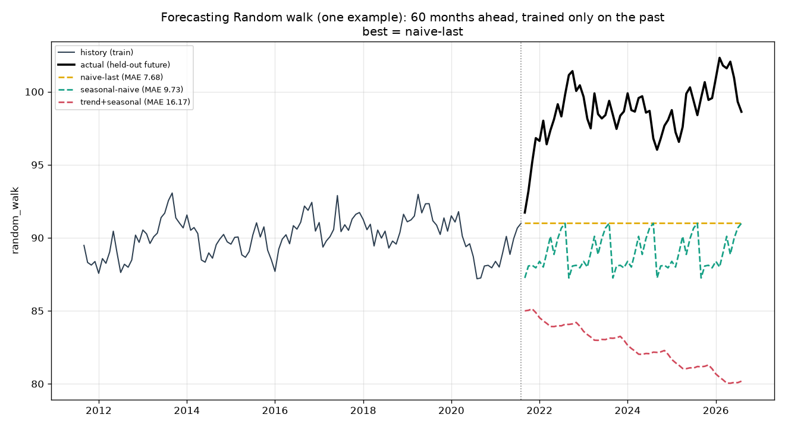
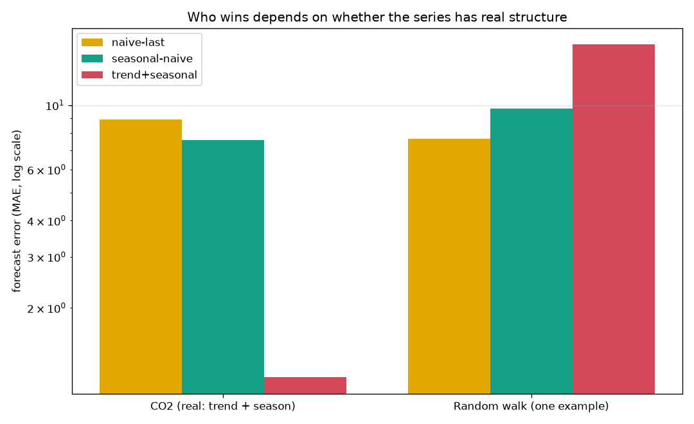

# Forecastable? — what you can and can't predict in a time series

Two lines can look almost identical on a chart: both wander, both trend, both have
ups and downs. Yet one of them you can forecast five years into the future almost
to the decimal, and the other you fundamentally cannot predict at all. This project
is about telling those two apart — and about the honest way to test any forecast.

It pits a genuinely predictable series, **atmospheric CO2** measured monthly at
Mauna Loa since 1958, against a **random walk**: a line that moves by pure
accumulated noise. Then it forecasts the held-out future of each and keeps score.

> **The finding:** on CO2, a simple trend-plus-season model forecasts 5 years ahead
> with a mean error of **~1 ppm (0.27%)** — beating the naive baseline **8-fold**.
> On random walks, that same model is the *worst* of the lot: averaged over 300 of
> them it lands roughly **twice** the error of just repeating the last value, and it
> beats that baseline only **23%** of the time. Real structure is predictable; noise
> that merely looks structured is a trap.

## Forecasting the future, honestly

The cardinal rule of time-series evaluation: **never shuffle.** You may only train
on the past and test on the future, because in real life that is all you ever have.
So each series has its last 60 months held out; every method forecasts that whole
stretch from the end of the training data, and is scored on the gap.

The second rule: **beat a naive baseline before believing a model.** Two are always
in the race — repeat-the-last-value, and repeat-last-season.

### CO2: real structure, genuinely predictable



The trend+seasonal model (red) rides both the relentless rise and the yearly
breathing cycle right through the held-out window. Repeating the last value (yellow)
falls behind as the trend climbs; seasonal-naive (teal) gets the wiggle but misses
the trend. Structure that is real and stable is structure you can extrapolate.

### A random walk: structure that isn't there



Here the actual future jumps *up*, but the flexible model (red) confidently
extrapolates a *downward* trend — because it fit a slope that existed only by chance
in the training tail. Simply repeating the last value (yellow) wins. The model isn't
buggy; it's doing exactly what it was told, on data that has nothing to learn.

### One example can lie — so average over many

A single random walk can flatter any method by luck (on some seeds the model even
"wins"). The honest claim comes from **300** of them:

```
Random walk, averaged over 300 seeds:
  method             mean MAE
  naive-last            4.304     <- lowest: unbeatable on structureless data
  seasonal-naive        4.779
  trend+seasonal        8.828     <- flexibility becomes a liability
```



The bars (log scale) tell the whole story: on CO2 the model's error is a fraction of
the baselines'; on the random walk it's a multiple of them. *Which method wins
depends entirely on whether the series has real structure* — and the only way to
know is an honest out-of-sample test.

## Install & run

```bash
pip install -r requirements.txt

# Analyze the CO2 series that ships with the repo (plus a random walk):
python -m forecastable

# ...or re-download fresh CO2 data from NOAA first:
python -m forecastable --collect
```

## How it works

- `data.py` — fetch NOAA Mauna Loa monthly CO2 (cached to `data/co2.csv`); generate
  reproducible random walks.
- `forecast.py` — the baselines (`naive_last`, `seasonal_naive`), the model
  (`trend_seasonal`: a least-squares **quadratic** trend plus monthly dummies — CO2
  rises *faster* than linearly, so the quadratic term is honest, not a fudge), the
  MAE/RMSE/MAPE metrics, the held-out `evaluate`, and the 300-seed random-walk
  experiment.
- `plots.py` — the two forecast charts and the error comparison.
- `cli.py` — the command-line entry point.

## Reading the result honestly

- **The quadratic trend is a modeling choice, and it can bite.** It's right for CO2
  (whose growth genuinely accelerates), but that same curvature is what makes the
  model extrapolate wild parabolas on a random walk. Flexibility helps only when
  there's real structure to catch.
- **"Forecastable" here means the structure is stable.** CO2's trend and seasonality
  have held for decades. A series can be predictable today and stop being so if its
  regime changes — the model assumes tomorrow's structure looks like yesterday's.
- **Financial prices behave like the random walk, not like CO2.** That's not a flaw
  in the model; it's the efficient-market lesson in miniature, and the reason a
  forecast must always be judged against the humble naive baseline.

## Tests

```bash
python -m pytest
```

All 11 tests run offline (no network) against synthetic series with a known answer:
the model must recover a planted trend-plus-season and beat both baselines, the
quadratic term must capture curvature, and — the headline claim — across many random
walks the naive baseline must have the lowest average error while the flexible model
fails to beat it more than half the time.
