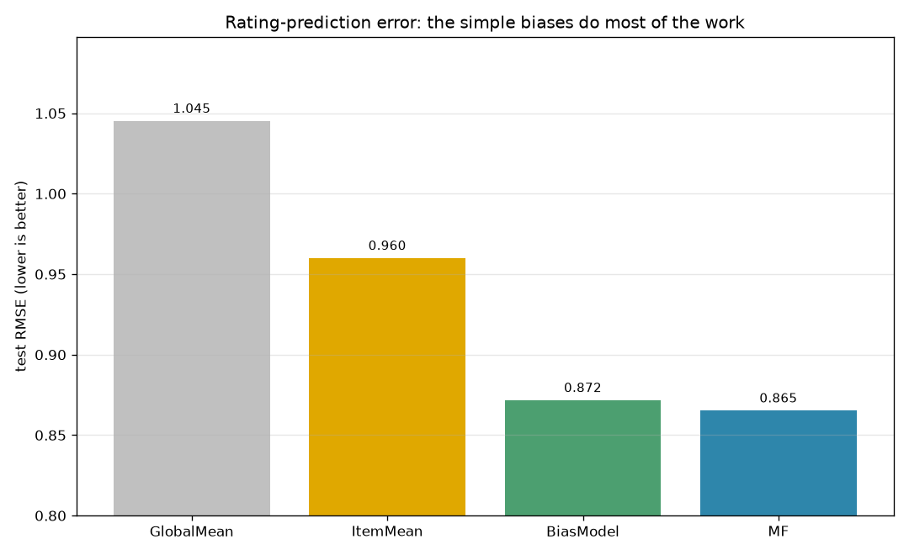
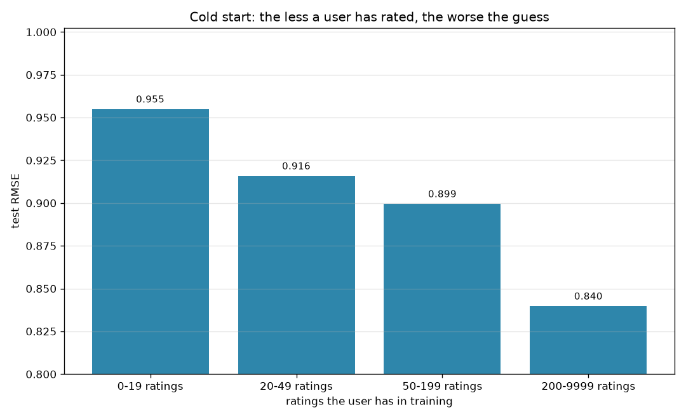
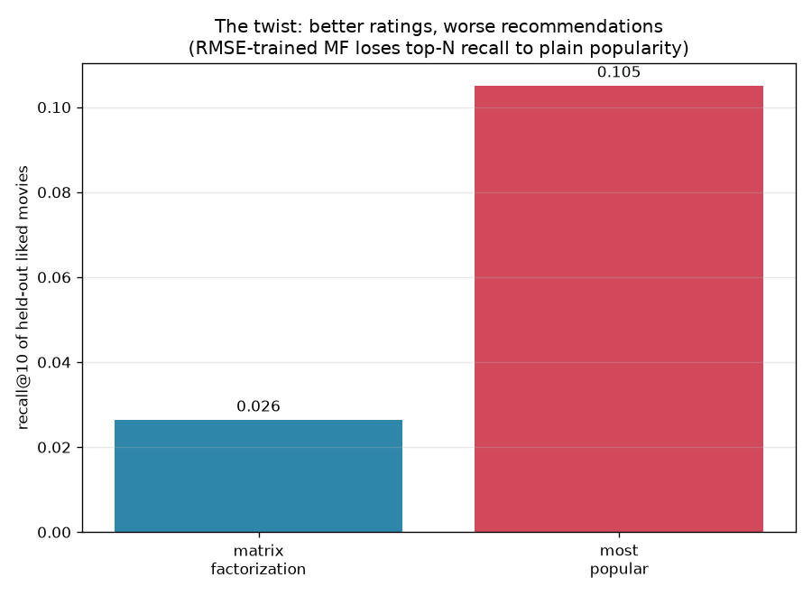

# Recommender — does matrix factorization beat "most popular"?

Every streaming service runs on a recommender, and the textbook answer to how is
**matrix factorization** — learn a hidden "taste vector" for every user and every
movie, and predict a rating from how well they align. This project builds that,
from scratch, on the MovieLens ratings (~100k ratings, 610 users, 9,700 movies) —
and then asks the question the textbook usually skips: *is it actually better than
just recommending whatever's popular?*

The answer has two honest halves, and they point in opposite directions.

## Half one: at predicting ratings, the fancy model barely wins



Four models, each adding a layer of sophistication, scored on held-out ratings:

```
GlobalMean   1.045      just predict the overall average
ItemMean     0.960      each movie's average (shrunk for rare movies)
BiasModel    0.872      global + "this user rates high" + "this movie is loved"
MF           0.865      the bias model + learned latent taste factors
```

The humble **bias model** — no machine learning, just per-user and per-movie offsets
— gets you to 0.872. Matrix factorization, with all its latent factors and gradient
descent, improves that to 0.865: a **0.7%** gain. Most of what's predictable about a
rating is simply that some people rate generously and some movies are widely loved.
(The Netflix Prize was famously won on margins this thin.)

## Cold start: the less someone has rated, the worse the guess



Split the error by how many ratings each user brought to training and the model's
dependence on data is stark: RMSE of 0.95 for users with fewer than 20 ratings,
falling to 0.84 for the most active. A recommender knows almost nothing about a
newcomer — the cold-start problem — which is exactly when services fall back to…
recommending what's popular.

## Half two: at actually recommending, popularity wins



RMSE measures whether predicted stars are close. But a recommender's real job is
*ranking* — putting a few things you'll love at the top of a short list. So the honest
test: hold out each user's highly-rated movies, have each model pick its top 10 from
everything the user hasn't seen, and measure how many of the held-out favourites it
recovers (recall@10).

```
matrix factorization: 0.026
most popular:          0.105
```

**Plain popularity recovers four times as many.** The twist is that the model with
the *better RMSE* is the *worse recommender*. Trained to nail individual ratings, the
matrix-factorization model happily fills its top 10 with obscure movies it overfit a
high score to, while "most popular" surfaces the broadly-loved films people are
actually likely to have watched and rated. Better at the metric everyone reports;
worse at the job.

## Install & run

```bash
pip install -r requirements.txt
python -m recommender                 # uses the committed MovieLens snapshot
python -m recommender --collect       # re-download MovieLens first
```

## Reading the result honestly

- **This isn't matrix factorization "failing" — it's being *misused*.** An
  RMSE-trained model is optimized for the wrong objective if you want a ranked list;
  models built *for* ranking (implicit-feedback ALS, BPR) close the gap. The lesson
  is to evaluate on the thing you actually care about, not the thing that's easy to
  measure.
- **Popularity is a genuinely strong baseline, and a trap.** It scores well on
  recall because held-out favourites skew popular, but it's identical for everyone —
  no personalization, no discovery. A good system blends the two; this project shows
  why you can't judge it on RMSE alone.
- **Small, dated, explicit-ratings data.** MovieLens is 0.5–5 star *explicit*
  ratings from a few hundred users; real systems mostly learn from *implicit* signals
  (clicks, watches) at vastly larger scale, where the trade-offs shift again.

## What's inside

- `data.py` — load MovieLens; a per-user train/test split (never a global one)
- `models.py` — `GlobalMean`, `ItemMean` (with shrinkage), `BiasModel`, and a
  from-scratch `MatrixFactorization` (biases + latent factors, SGD)
- `evaluate.py` — RMSE, RMSE by user activity (cold start), and top-N recall vs
  popularity
- `plots.py` — the RMSE ladder, the cold-start bars, and the ranking comparison
- `cli.py` — the command-line entry point

## Tests

```bash
python -m pytest
```

All 9 tests run offline against synthetic ratings built from known biases and latent
factors: the per-user split must leave every test user in training, item means must
shrink toward the global mean for rare movies, predictions must stay in range, and —
the headline — on data with real latent structure, matrix factorization must beat the
bias model, which must beat the global mean.
