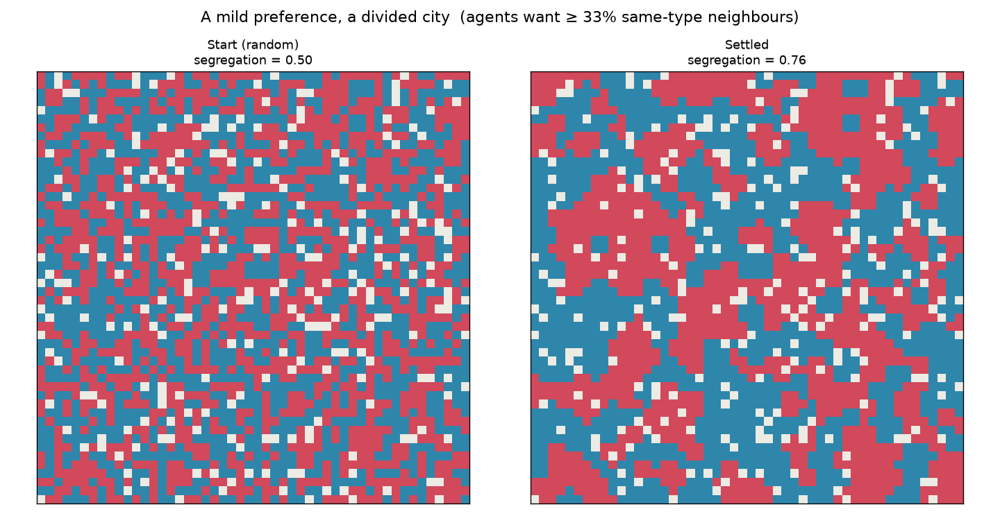
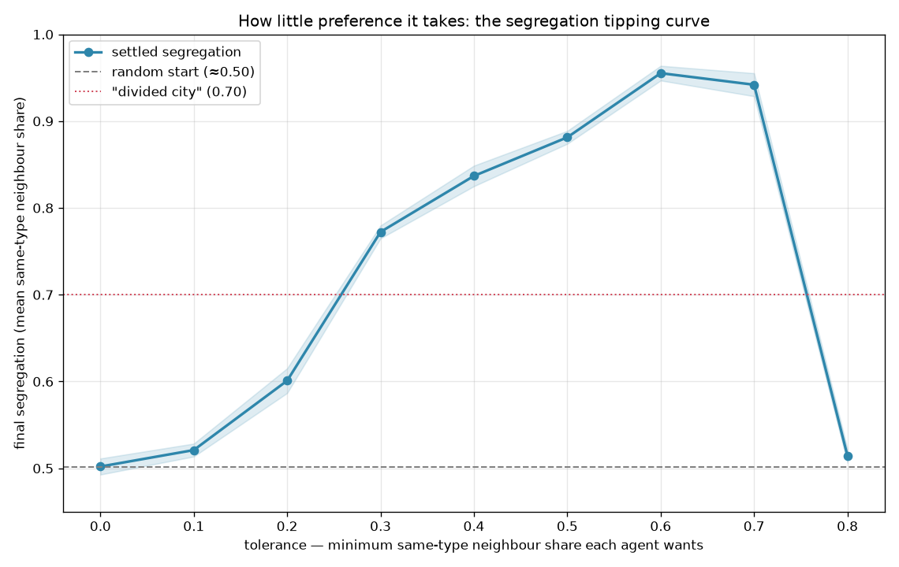

# Schelling — how a mild preference builds a divided city

Here is an uncomfortable question from 1971, and it still unsettles people: suppose
nobody in a city wants segregation. Everyone is happy living as a minority — they
ask only that *some* of their neighbours be like them. What does the city look like
once everyone has settled in?

The economist Thomas Schelling showed, with a checkerboard and coins, that the
answer is: **segregated anyway**. Mild individual preferences no one would call
prejudice cascade into stark collective division. This project rebuilds his model as
an agent-based simulation and measures exactly how little preference it takes.

> **The finding:** when each agent wants only **a third** of its neighbours to match
> its own type — perfectly content to be a two-thirds minority — a randomly mixed
> city (segregation ≈ 0.50) settles into a visibly divided one (≈ 0.76). A "divided
> city" emerges once agents want just **~30%** of their neighbours to be similar. No
> one chose segregation; it emerged from choices no one thought extreme.

## A mild preference, a divided city



Left: a random 50/50 mix. Right: the same city after agents who were below their
(mild) threshold relocated, repeatedly, until everyone was content. Same rules, same
people — coherent territories formed on their own.

## How little it takes: the tipping curve



Sweeping the one knob that matters — how large a same-type share each agent insists
on — reveals a sharp tipping point. Below ~20% preference the city stays mixed;
across ~30% it lurches past the "divided city" line and keeps climbing. The band is
the spread across random trials.

```
 tolerance   final segregation
       0%          0.50   (unchanged — nobody ever wants to move)
      20%          0.60
      30%          0.77   <- already a divided city
      50%          0.88
      60%          0.96
      80%          0.51   <- see "reading it honestly" below
```

## How it works

1. **Grid** (`model.py`) — a lattice of cells, each empty or home to a type-A or
   type-B agent. An agent is *content* when the share of its occupied 8-neighbours
   matching its own type is at least `tolerance`.
2. **Dynamics** — each round, every discontent agent moves to a random empty cell.
   Repeat until everyone is content or a round cap is hit.
3. **Measure** — `segregation` is the mean same-type-neighbour share across occupied
   cells (≈0.5 when well mixed, →1.0 when fully sorted).
4. **Sweep** (`experiment.py`) — run the model across a range of tolerances, several
   trials each, to trace the tipping curve and locate the threshold.

## Reading the result honestly

- **This is a mechanism, not a map of any real city.** Schelling's point is a
  *possibility* proof: segregation can arise with no bigotry, no discrimination, no
  policy — from mild preference alone. Real segregation also involves income,
  lending, zoning, and outright discrimination, which this toy leaves out entirely.
  The model shows one force is *sufficient*; it does not claim it is the *only* one.
- **The curve turns back down at extreme tolerance (the 80% point).** When agents
  demand that most neighbours match, almost no arrangement satisfies them, so they
  never stop moving — the city churns randomly and never settles, and the
  segregation measure falls back toward 0.5. That is not integration; it is a model
  with no equilibrium, and it's flagged (runs there hit the round cap without
  converging) rather than hidden.
- **The relocation rule is a simplification.** Agents here jump to a *random* empty
  cell; other rules (move to the nearest acceptable spot) change the speed but not
  the qualitative story.

## Install & run

```bash
pip install -r requirements.txt

python -m schelling                      # default: 50x50 grid, 33% tolerance
python -m schelling --tolerance 0.5      # fussier agents
python -m schelling --size 80 --empty 0.2
```

## Tests

```bash
python -m pytest
```

All 13 tests run offline and deterministically: the neighbour-share calculation is
checked by hand, a fully segregated grid must score high while a random one scores
~0.5, zero tolerance must freeze the city exactly as it started, a moderate
preference must raise segregation well above the random baseline, and the sweep must
reproduce the tipping behaviour — flat at zero preference, sharply higher with a
little.
