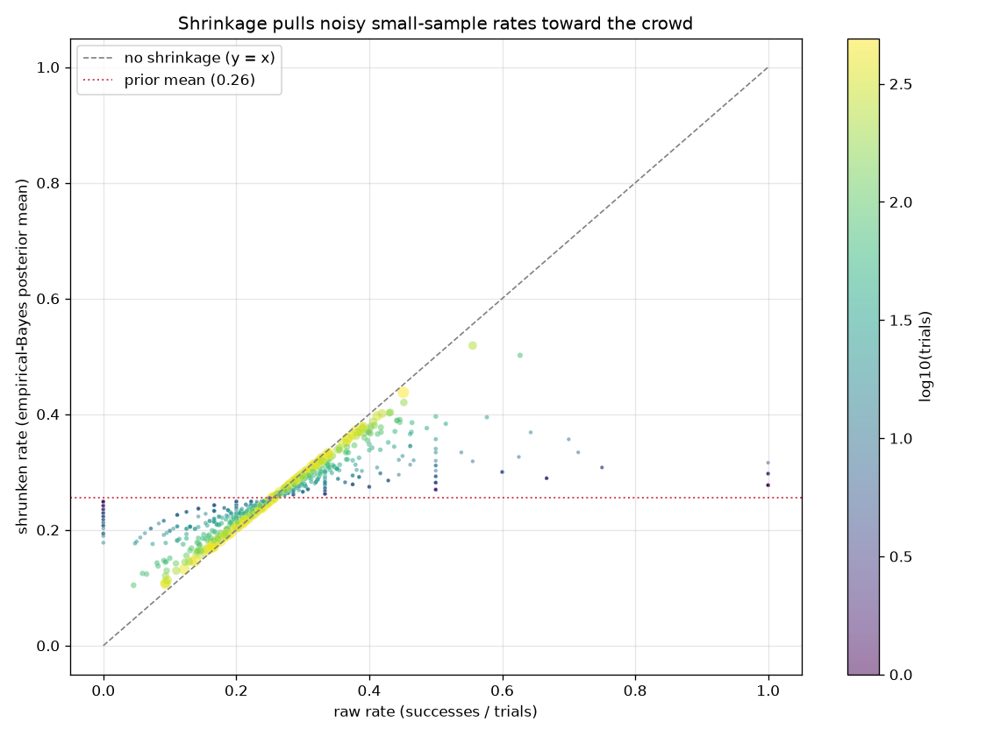
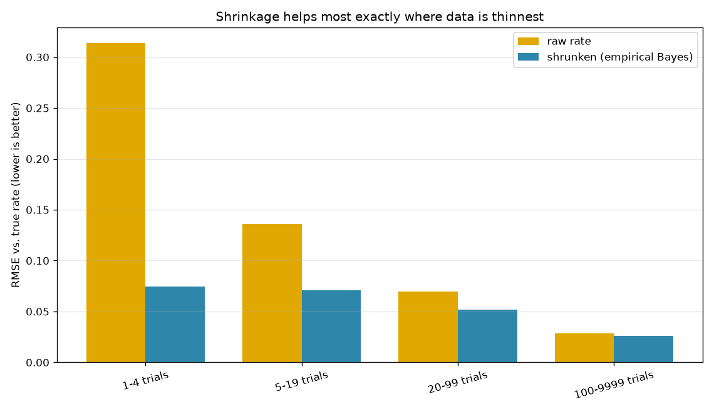
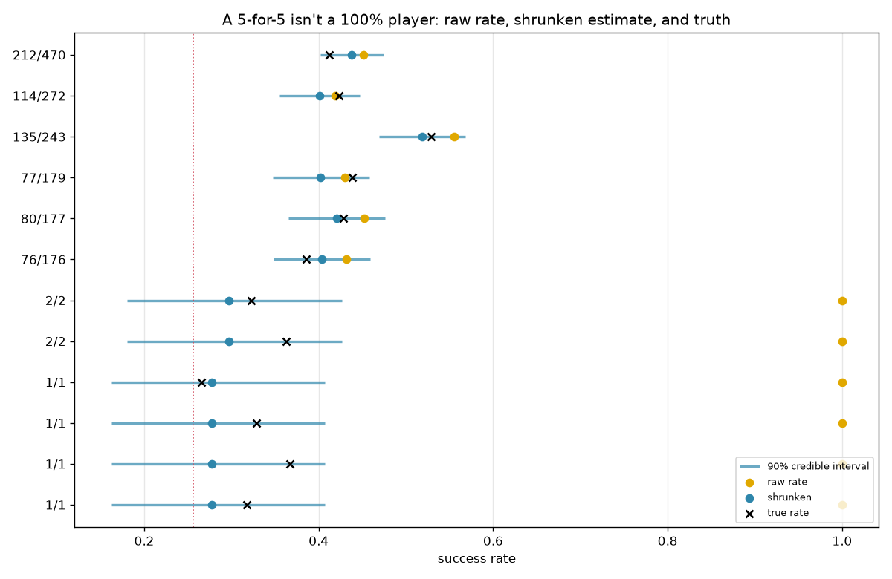

# Small Samples — why a 100% success rate usually means nothing

Someone goes 5-for-5. Someone else goes 150-for-500. Who's better? The raw rates say
100% versus 30% — not close. But the first number is almost pure luck, and treating
it as skill is one of the most common ways data misleads us: in sports stats,
A/B tests, review scores, hospital rankings, "top-rated" anything.

This project fixes it with **empirical Bayes** — a Bayesian method that pulls every
rate toward the crowd's average, trusting the data more when there's a lot of it and
the crowd more when there's little. Because the whole study runs on a *simulation*
where the true rates are known, it can prove the shrunken estimates are genuinely
closer to the truth — the honest test a real leaderboard can never give you.

> **The finding:** across 1,000 simulated players, empirical-Bayes shrinkage cuts the
> error-versus-truth by **3x** (RMSE 0.17 → 0.06), and the gain is largest exactly
> where it's needed — a **76%** improvement for players with fewer than 5 trials. The
> naive "best player" (3-for-3, a perfect 100%) had a true rate of just 37%; its raw
> rate was noise. The raw-rate top 10 shared **zero** players with the real top 10.

## How shrinkage works

With a Beta(α, β) prior, a player with `s` successes in `n` trials has a posterior
mean of

```
(α + s) / (α + β + n)
```

which is just a weighted average of their raw rate and the prior mean — as if
everyone began with `α` phantom successes and `β` phantom failures. For a 5-for-5
player those phantom failures crush 100% back toward the average; for a 150-of-500
player they're a rounding error. **The prior is a crowd of imaginary trials, and
small samples are the ones it outvotes.** Empirical Bayes just estimates that prior
from the whole population (here by maximum likelihood on the Beta-Binomial).



Every point is a player: raw rate across, shrunken rate up, colored by how many
trials back it. Well-measured players (bright) sit on the diagonal — barely touched.
Thinly-measured players (dark) collapse toward the prior mean, because their raw
rates carried almost no information.

## It helps most where data is thinnest



```
 bucket            players    raw   shrunk   better
 1-4 trials            252   0.314  0.075    76%
 5-19 trials           198   0.136  0.071    48%
 20-99 trials          278   0.069  0.052    25%
 100+ trials           272   0.028  0.026     7%
```

For well-measured players there's little noise to remove, so shrinkage leaves them
alone. For tiny samples it's transformative — which is the point: it intervenes in
proportion to how little you actually know.

## Raw rate, shrunken estimate, and the truth



The well-measured players (top) barely move, with tight credible intervals. The
1-for-1 and 2-for-2 players (bottom) have raw rates pinned at 100%, but their
shrunken estimates land near the truth (the x) with honestly wide intervals — the
model says, correctly, "I don't really know yet."

## Install & run

```bash
pip install -r requirements.txt
python -m small_samples              # 1000 players; prints the tables, saves charts
python -m small_samples --players 5000 --seed 3
```

## Reading the result honestly

- **Shrinkage trades a little bias for a lot of variance.** It deliberately pulls
  estimates toward the mean, so a genuinely exceptional player with a small sample
  gets under-estimated — on purpose. The win is that it's wrong by *less, on
  average* than trusting raw rates. If your single goal is to not miss a true
  superstar, that bias matters and you'd want wider intervals, not point estimates.
- **It assumes the players share a population.** The prior is one Beta fit to
  everyone; if the field is really a mix of very different groups, a single prior
  over-shrinks the tails. (Hierarchical models are the next step up.)
- **Ranking stays hard.** Even shrunken, picking the exact top 10 of 1,000 is noisy
  (Spearman rank correlation with the truth rises from 0.49 to 0.63 — better, not
  magic). The honest message isn't "shrinkage finds the best"; it's "raw rates
  definitely don't."

## What's inside

- `simulate.py` — draw true rates from a Beta prior, give players wildly unequal
  trial counts, and observe noisy successes (keeping the truth for scoring)
- `shrink.py` — fit the Beta prior by Beta-Binomial maximum likelihood, then the
  posterior mean and credible interval for each player
- `evaluate.py` — RMSE vs. truth overall and by sample size, plus ranking checks
- `plots.py` — the shrinkage scatter, the error-by-size bars, and the examples
- `cli.py` — the command-line entry point

## Tests

```bash
python -m pytest
```

All 10 tests run offline and deterministically: the prior fit must recover the Beta
it was simulated from, every posterior mean must sit between the raw rate and the
prior, small samples must shrink harder than large ones, and — the headline — the
shrunken estimates must beat raw rates against the known truth, by the most for the
smallest samples.
